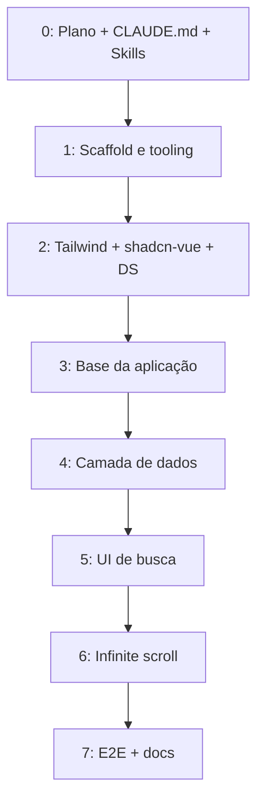

# 🚀 SpaceXplorer (Vue) — Plano de Desenvolvimento

> **Projeto:** Vue SpaceXplorer (NASA Image API Explorer)
> **Referência:** `projeto-exemplo-em-react/react-spacexplorer` (será **removido** em breve)
> **Data:** 27/09/2026
> **Status:** ✅ Implementado (27/09/2026) — paridade verificada pelos testes E2E

---

## 📌 Visão Geral

Reescrever o SpaceXplorer em **Vue 3.5** mantendo **exatamente as mesmas funcionalidades**
do projeto React de referência: busca na NASA Images and Video Library API com debounce,
infinite scroll, estados de loading/erro/vazio, cards expansíveis e tema dark/light.

Como a pasta React será apagada, **este documento é a especificação funcional completa**
(seção [Especificação Funcional](#-especificação-funcional)). Nenhuma decisão deve depender
de consultar o código React.

> ⚠️ **Só remover `projeto-exemplo-em-react/` depois da Etapa 7** (os testes E2E precisam
> ser portados antes — eles são a verificação objetiva de paridade).

---

## 🧱 Stack

| Camada                  | Tecnologia                                       | Versão    | Observação                                                                            |
| ----------------------- | ------------------------------------------------ | --------- | ------------------------------------------------------------------------------------- |
| Framework               | Vue                                              | **3.5.x** | `<script setup lang="ts">`, Composition API. (3.6 ainda em RC — não usar)             |
| Bundler                 | Vite                                             | 8.x       | `@vitejs/plugin-vue` 6.x                                                              |
| Linguagem               | TypeScript                                       | **6.0.x** | ⚠️ **Não** usar TS 7 (port nativo em Go): `vue-tsc` depende da API JS do TS           |
| Type check              | vue-tsc                                          | 3.x       | `vue-tsc --build`                                                                     |
| Estilização             | Tailwind CSS                                     | 4.x       | `@tailwindcss/vite`, sem `tailwind.config.js`                                         |
| Componentes UI          | shadcn-vue                                       | 2.x       | Primitivos **Reka UI** (equivalente ao Radix)                                         |
| Ícones                  | `@lucide/vue`                                    | 1.x       | Pacote que o shadcn-vue atual usa (`lucide-vue-next` está descontinuado)              |
| Data fetching           | `@tanstack/vue-query`                            | 5.x       | + `@tanstack/vue-query-devtools` (somente dev)                                        |
| Composables utilitários | `@vueuse/core`                                   | 15.x      | debounce, título, tema, visibilidade do sentinel                                      |
| HTTP                    | Axios                                            | 1.x       |                                                                                       |
| Datas                   | date-fns                                         | 4.x       |                                                                                       |
| Variantes               | class-variance-authority + clsx + tailwind-merge | latest    | `cn()`                                                                                |
| Lint                    | ESLint 10 (flat)                                 |           | `eslint-plugin-vue`, `@vue/eslint-config-typescript`, `@tanstack/eslint-plugin-query` |
| Formatação              | Prettier 3                                       |           | `prettier-plugin-tailwindcss`, `@vue/eslint-config-prettier`                          |
| Testes unitários        | Vitest + @vue/test-utils                         | 5.x / 2.x | **Novo** em relação ao React                                                          |
| Testes E2E              | Playwright                                       | 1.x       | Portados 1:1 do React                                                                 |
| DX                      | vite-plugin-vue-devtools                         | 8.x       | Somente dev                                                                           |

### Deliberadamente fora do escopo

- **Vue Router** — app de página única, sem rotas (o React também não tinha).
- **Pinia** — não há estado global além do tema; um composable compartilhado resolve.
  Se surgir estado global de verdade, aí sim entra Pinia.
- **SSR / Nuxt** — SPA estática, igual à referência.

---

## 🔁 Mapa de Equivalência React → Vue

| React (referência)                                          | Vue (alvo)                                                                                   |
| ----------------------------------------------------------- | -------------------------------------------------------------------------------------------- |
| `App.tsx` + `AppProviders`                                  | `main.ts` (`app.use(VueQueryPlugin, …)`) + `App.vue` (`TooltipProvider`)                     |
| `QueryProvider.tsx` + `ReactQueryDevtools`                  | `VueQueryPlugin` + `<VueQueryDevtools />` só em dev                                          |
| `ThemeProvider` + `theme-context` + `useTheme`              | `composables/useTheme.ts` (`useColorMode` + `createSharedComposable`)                        |
| `useDebouncedValue`                                         | `refDebounced` (VueUse)                                                                      |
| `useIntersectionObserver` (callback ref + `useEffectEvent`) | `useIntersectionObserver` (VueUse) com `pause`/`resume` → `composables/useInfiniteScroll.ts` |
| `<title>` no JSX                                            | `useTitle(computed(...))` (VueUse)                                                           |
| `react-error-boundary` com `resetKeys`                      | `components/ErrorBoundary.vue` (`onErrorCaptured` + `watch` da key)                          |
| `useInfiniteQuery({...})`                                   | `useInfiniteQuery(() => ({...}))` — **getter** reativo                                       |
| `useState`                                                  | `ref` / `shallowRef`                                                                         |
| Estado derivado                                             | `computed` (nunca `watch` + atribuição)                                                      |
| Props `value` + `onChange`                                  | `defineModel()` (`v-model`)                                                                  |
| Callback props (`onSuggestionSelect`)                       | `defineEmits<{ select: [value: string] }>()`                                                 |
| `className` + `cn()`                                        | prop `class` (`HTMLAttributes['class']`) + `cn()`                                            |
| `asChild` (Radix Slot)                                      | `as-child` (Reka UI `Primitive`)                                                             |
| `lucide-react`                                              | `@lucide/vue`                                                                                |
| `Header.tsx` / `Footer.tsx`                                 | `AppHeader.vue` / `AppFooter.vue` (nomes multi-palavra — regra do style guide)               |

---

## 🗂️ Estrutura de Pastas Alvo

```
vue-spacexplorer/
├── .claude/skills/                 # Skills do projeto (Etapa 0)
├── e2e/                            # Playwright (portado do React)
│   ├── support/{test.ts,nasa-fixtures.ts}
│   └── *.spec.ts
├── public/favicon.ico
├── src/
│   ├── assets/main.css             # Tailwind + tokens do design system
│   ├── components/
│   │   ├── ui/                     # shadcn-vue gerado (não editar à mão)
│   │   └── ErrorBoundary.vue
│   ├── composables/
│   │   ├── useInfiniteScroll.ts
│   │   └── useTheme.ts
│   ├── features/search/
│   │   ├── api/nasa-api.ts
│   │   ├── components/
│   │   │   ├── SearchPage.vue
│   │   │   ├── SearchInput.vue
│   │   │   ├── SearchResults.vue
│   │   │   ├── SearchSuggestions.vue
│   │   │   ├── SearchCard.vue
│   │   │   ├── SearchCardSkeleton.vue
│   │   │   └── SearchErrorFallback.vue
│   │   ├── composables/useSearchInfinite.ts
│   │   ├── lib/select-results.ts   # toResultItem + selectResults (puro, testável)
│   │   ├── lib/select-results.test.ts
│   │   └── types/nasa-api.ts
│   ├── layouts/{RootLayout,AppHeader,AppFooter}.vue
│   ├── lib/{utils.ts,query-client.ts}
│   ├── App.vue
│   ├── main.ts
│   └── env.d.ts
├── index.html
├── CLAUDE.md
├── PLANNING.md
└── (configs: vite, vitest, tsconfig.*, eslint, prettier, playwright, components.json)
```

---

## 📋 Especificação Funcional

> Textos da UI são em **inglês** e devem ser idênticos (os testes E2E dependem deles).

### Configuração

- `.env` / `.env.production`: `VITE_BASE_URL=https://images-api.nasa.gov`, `VITE_APP_TITLE=SpaceXplorer`
- Endpoint: `GET {VITE_BASE_URL}/search?q={q}&page={page}&page_size=20` — Axios com `timeout: 15_000`,
  repassando o `AbortSignal` da query.

### `index.html`

- `<html lang="en" class="dark">`; `meta description` = "Search NASA's image and video library.";
  `theme-color` `#0b1120`; favicon `/favicon.ico`.
- Fonte Inter (Google Fonts, pesos 400–800) + `preconnect` para `fonts.googleapis.com`,
  `fonts.gstatic.com`, `images-api.nasa.gov`, `images-assets.nasa.gov`.
- `<title>SpaceXplorer</title>`.
- **Script inline antes do paint**: se `localStorage.getItem('theme') === 'light'`, remove a classe
  `dark` do `<html>` (dentro de `try/catch`). Garante zero flash de tema.

### Layout

- Wrapper `flex min-h-dvh flex-col` com utilitário `stars-bg` (fundo de estrelas).
- **Header** (`<header>`, sticky, `bg-background/80 backdrop-blur-md`, borda inferior):
    - Link `href="/"` com ícone `Rocket` + texto "Space**X**plorer" (o "X" com `text-primary`).
      Nome acessível: **"SpaceXplorer"**.
    - Botão ghost/icon de tema com `aria-label` e tooltip **"Switch to light mode"** (quando dark,
      ícone `Sun`) / **"Switch to dark mode"** (quando light, ícone `Moon`).
- **Main**: `container mx-auto max-w-7xl flex-1 px-4 py-8 sm:px-6 lg:px-8`.
- **Footer** (`<footer>`, borda superior): "Powered by the **NASA Images API**" (link para
  `https://images.nasa.gov/docs/images.nasa.gov_api_docs.pdf`, nova aba, `noopener noreferrer`)
  · "Developed by Marcus Melo" + ícone `Rocket`. O "·" só aparece em `sm+`.

### Tema

- Dark por padrão; toggle alterna `dark`/`light`, aplica/remove a classe `dark` no `<html>` e
  persiste em `localStorage['theme']` (`'dark' | 'light'`). Falha de storage é ignorada.

### Busca (`SearchPage`)

- Hero: `<h1>` **"Explore the cosmos"** ("cosmos" com gradiente `from-cyan-400 to-blue-500`
  `bg-clip-text text-transparent`); subtítulo **"Search decades of images and videos from NASA's missions."**
- Valor inicial do input: **"Saturn"**. Debounce de **400 ms** sobre o valor com `trim()`.
- `isDebouncing = input.trim() !== query` → mostra spinner no input.
- Título do documento: `"{query} · SpaceXplorer"` ou `"SpaceXplorer"` se vazio.
- Resultados envoltos por um **ErrorBoundary** cujo reset acontece quando a `query` muda.
  Fallback: Alert destructive **"Something went wrong displaying the results"** /
  "Try again, or search for something else." + botão **"Try again"**.

### `SearchInput`

- `<form role="search">` com `submit.prevent`.
- `<label class="sr-only">` **"Search the NASA image library"** ligado ao input.
- `<input type="search">` (role `searchbox`), `autocomplete="off"`, `autofocus`,
  placeholder **"Search the universe — Saturn, nebula, Apollo 11…"**, altura 14, `text-lg`,
  ícone `Search` à esquerda, botão de cancelar nativo do webkit oculto.
- À direita: se `isSearching` → `Loader2` girando com `aria-label="Searching"`; senão, se houver
  valor → botão ghost/icon **"Clear search"** (`X`) que limpa o valor.

### `SearchResults` — estados (nesta ordem de prioridade)

1. **Query vazia** → ícone `Telescope` + "Start typing to explore NASA's image and video library."
    - sugestões. **Nenhuma** requisição à API.
2. **Carregando** (`isLoading`, **ou** `isPlaceholderData` com dados anteriores vazios) →
   `role="status"` `aria-label="Loading results"` com **6** `SearchCardSkeleton`.
3. **Erro sem dados** → Alert destructive **"Something went wrong"** /
   "We couldn't reach the NASA library: {error.message}" + botão **"Try again"** (`refetch`).
4. **Zero resultados** → Alert (ícone `SearchX`) **"No results for “{query}”"** /
   "Try one of these searches instead:" + sugestões.
5. **Com resultados** →
    - `<p aria-live="polite">`: se `isPlaceholderData` → **"Searching for “{query}”…"**; senão
      **"{total} results for “{query}”"** (total com `Intl.NumberFormat()`, em negrito).
    - `<ul aria-label="Search results" :aria-busy="isPlaceholderData">` grid
      `grid-cols-1 md:grid-cols-2 xl:grid-cols-3 gap-6`; `opacity-50` enquanto placeholder.
      Cada `<li>` com `key = item.id`.
    - Sentinel `aria-hidden` `h-px` para infinite scroll (`rootMargin: 600px`).
    - `isFetchingNextPage` → `role="status"` `aria-label="Loading more results"` com uma linha de
      `SearchCardSkeleton` (1 no mobile, 2 em `md`, 3 em `xl`) + texto `sr-only` "Loading more…".
      Fica **fora** da `<ul>` (placeholders não contam como resultados).
    - `isFetchNextPageError` → **"Couldn't load more results."** + botão **"Retry"**.
    - Sem próxima página e não-placeholder → **"You've reached the edge of the known universe. 🚀"**

- **Sugestões:** `Earth, Mars, Saturn, Nebula, Apollo 11, Hubble` — botões outline `sm`
  arredondados; clicar define o input com o valor.

### Dados (`useSearchInfinite`)

- `queryKey: ['search', trimmedQuery]` (factory `searchKeys`).
- `initialPageParam: 1`; `getNextPageParam`: próxima página **somente** se
  `collection.links` contém `rel === 'next'` (NÃO calcular por `total_hits` — a API para de
  paginar em ~10k itens).
- `select`: achata páginas → `SearchResultItem[]`, **deduplicando por `nasa_id`**;
  `totalHits = pages[0].collection.metadata.total_hits`.
- `toResultItem`: usa `data[0]` (descarta item sem data); preview = link `rel === 'preview'`
  (ou o primeiro link); `previewUrl` só se `render === 'image'`; `keywords ?? []`.
- `enabled: trimmed.length > 0`; `placeholderData: keepPreviousData`;
  `staleTime: 5 min`; `gcTime: 30 min`.
- `QueryClient` global: `retry` → não repete **4xx**; repete até **2x** rede/5xx;
  `refetchOnWindowFocus: false`.

### `SearchCard`

- Card com glassmorphism, `animate-fade-in-up`, hover `scale-[1.02]` + borda/sombra cyan.
- Mídia `aspect-video`: `` com zoom no hover;
  enquanto carrega, `Skeleton` pulsante por baixo e a imagem em `opacity-0` (fade-in no `load`);
  se a imagem falhar (`error`), mostra o placeholder "No preview available";
  sem preview → ícone `Music` (audio) ou `ImageOff` + **"No preview available"** (sem ``).
  Vídeo com preview → ícone `PlayCircle` centralizado (`aria-hidden`).
- Linha de metadados: Badge outline do media type (`image` cyan, `video` violet, `audio` amber,
  `capitalize` visual — texto no DOM em minúsculas); data com `Calendar` em
  `<time :datetime>` formato date-fns **`dd MMM yyyy`** (omitida se inválida); `center` à direita.
- Título em **`<h2>`** com `line-clamp-2`.
- Descrição `line-clamp-3` (remove o clamp quando expandido), `whitespace-pre-line`.
- Expandido → até **6** keywords como Badge secondary, com ícone `Tag`.
- Footer: botão ghost **"Show more" / "Show less"** com `aria-expanded`; link
  **"View on NASA"** + `ExternalLink` → `https://images.nasa.gov/details/{encodeURIComponent(id)}`,
  `target="_blank" rel="noopener noreferrer"`.

### Design system / CSS

Portar integralmente os tokens do `index.css` React para `src/assets/main.css`
(ver skill `design-system`): variáveis `:root` (light) e `.dark`, `@theme inline`, cores
`space-950/900/800`, `--glow`, `--star`, raio `0.75rem`, keyframe `fade-in-up` (0.4s),
utilitário `stars-bg`, `@custom-variant dark`, `color-scheme` e `prefers-reduced-motion`.

---

## 🗺️ Etapas

### Etapa 0 — Planejamento, CLAUDE.md e Skills ✅

- [x] `PLANNING.md` (este arquivo) com especificação funcional completa
- [x] `CLAUDE.md` com convenções do projeto Vue
- [x] Skills em `.claude/skills/`: `vue3`, `tanstack-vue-query-v5`, `vueuse`, `tailwind-v4`,
      `shadcn-vue`, `design-system`, `testing`

### Etapa 1 — Scaffold e tooling

- [x] `.gitignore` (git fica a cargo do usuário)
- [x] Vite 8 + Vue 3.5 + TS 6 (scaffold manual na raiz — a pasta não está vazia)
- [x] `tsconfig.json` com references: `tsconfig.app.json` (`@vue/tsconfig`), `tsconfig.node.json`,
      `tsconfig.vitest.json`, `tsconfig.e2e.json`; alias `@/*` em todos
- [x] `vite.config.ts`: `vue()`, `vueDevTools()`, `tailwindcss()`, alias `@`
- [x] `src/env.d.ts` tipando `VITE_BASE_URL` e `VITE_APP_TITLE`; `.env` e `.env.production`
- [x] ESLint flat config (vue `flat/recommended`, TS type-checked, TanStack Query, `no-console`
      exceto warn/error, ignorar `src/components/ui`) + Prettier (4 espaços, aspas simples,
      `es5`, plugin Tailwind com `tailwindFunctions: ['cn', 'cva']`)
- [x] Scripts: `dev`, `build` (`vue-tsc --build && vite build`), `typecheck`, `lint`, `format`,
      `preview`, `test:unit`, `test:e2e`, `test:e2e:ui`, `test:e2e:report`
- [x] Validar: `npm run typecheck && npm run lint && npm run build`

### Etapa 2 — Tailwind v4 + shadcn-vue + Design System

- [x] `tailwindcss`, `@tailwindcss/vite`, `tw-animate-css`
- [x] `npx shadcn-vue@latest init` (style new-york, base slate, CSS vars) → `components.json`
- [x] `npx shadcn-vue@latest add button input card skeleton alert badge separator tooltip`
- [x] `src/assets/main.css` com os tokens do design system (substituir o que o init gerar)
- [x] `index.html` completo (fontes, preconnects, meta, script anti-flash); copiar `favicon.ico`

### Etapa 3 — Base da aplicação

- [x] `lib/utils.ts` (`cn`) e `lib/query-client.ts` (retry policy)
- [x] `main.ts`: `createApp(App).use(VueQueryPlugin, { queryClient }).mount('#app')`
- [x] `composables/useTheme.ts` (compartilhado; storage key `theme`)
- [x] `layouts/RootLayout.vue`, `AppHeader.vue` (toggle + tooltip), `AppFooter.vue`
- [x] `App.vue`: `TooltipProvider` > `RootLayout` > `SearchPage`; devtools só em dev
- [x] `components/ErrorBoundary.vue`

### Etapa 4 — Camada de dados

- [x] `features/search/types/nasa-api.ts` (tipos da API + `SearchResultItem`/`SearchResults`)
- [x] `features/search/api/nasa-api.ts` (instância Axios, `PAGE_SIZE = 20`, `signal`)
- [x] `features/search/lib/select-results.ts` + **testes Vitest** (mapeamento, dedupe, preview, audio)
- [x] `features/search/composables/useSearchInfinite.ts` (getter de opções, `searchKeys`)

### Etapa 5 — UI de busca

- [x] `SearchInput.vue` (`defineModel`, `useId`), `SearchSuggestions.vue`
- [x] `SearchCard.vue` + `SearchCardSkeleton.vue`
- [x] `SearchResults.vue` (todos os estados da especificação)
- [x] `SearchErrorFallback.vue` + `SearchPage.vue` (hero, `refDebounced`, `useTitle`, boundary)

### Etapa 6 — Infinite scroll

- [x] `composables/useInfiniteScroll.ts`: `useIntersectionObserver` com `pause`/`resume` guiado
      por `enabled` — o observer é recriado quando uma página termina, e sua primeira medição já
      reflete o layout novo (ver skill `vueuse` sobre por que `useElementVisibility` não serve).
- [x] Desabilitar enquanto `isFetchingNextPage`, sem `hasNextPage` ou com `isFetchNextPageError`

### Etapa 7 — Testes E2E e documentação

- [x] Copiar `e2e/` e `playwright.config.ts` do React (import de tipos via `@/features/search/types/nasa-api`)
- [x] Todos os specs passando em **desktop e mobile**: `search`, `search-card`, `infinite-scroll`,
      `errors`, `theme`, `layout` (+ `live` opt-in com `E2E_LIVE=1`)
- [x] `README.md` + screenshots em `docs/images/`
- [x] ✅ Liberar remoção de `projeto-exemplo-em-react/`



> Cada etapa termina com `typecheck`, `lint` e `build` verdes. As etapas 4–6 podem ser
> validadas antecipadamente copiando o spec E2E correspondente.

---

## ✅ Critérios de Conclusão

- [x] Paridade funcional: todos os specs E2E do React passando sem alterar asserções
- [x] Testes unitários de `select-results` passando
- [x] `npm run typecheck`, `npm run lint` e `npm run build` sem erros nem warnings
- [x] Zero `any`, zero `console.log`, zero Options API
- [x] Dark/light com persistência e sem flash
- [x] Sem scroll horizontal no mobile
- [x] Devtools ausentes do bundle de produção
