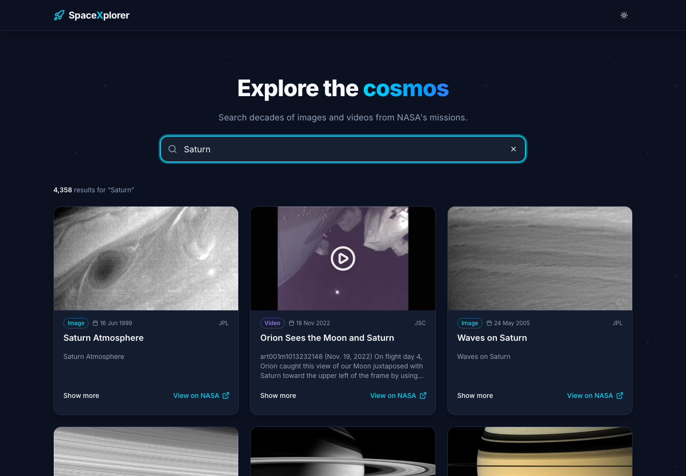
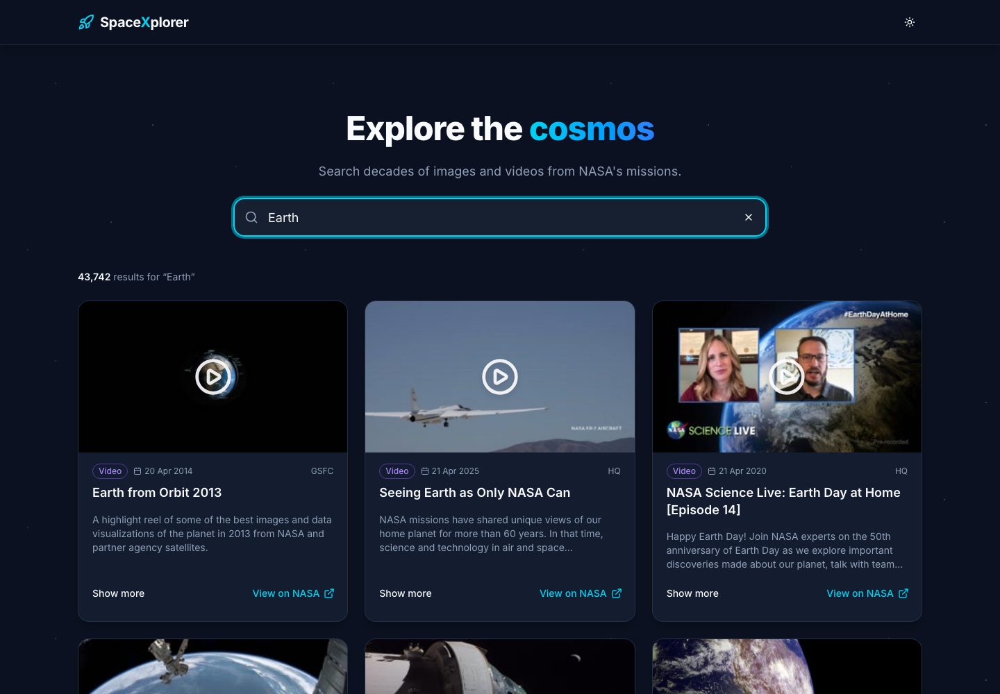

# 🚀 SpaceXplorer (Vue)

Search NASA's image and video library with infinite scroll.

**Stack:** Vue 3.5 · Vite 8 · TypeScript 6 · Tailwind CSS v4 · shadcn-vue (Reka UI) · TanStack Vue Query v5 · VueUse · Axios · date-fns

---

## 📸 Screenshots

### Saturn Search



### Earth Search



---

## 🚀 Getting Started

```bash
npm install
npm run dev          # http://localhost:5173
npm run build        # typecheck + production build
npm run lint
npm run test:unit    # Vitest
npm run test:e2e     # Playwright (production build, mocked API)
```

Configure the API in `.env` (`VITE_BASE_URL`, `VITE_APP_TITLE`).

## 🔗 Links

- [NASA Images API docs](https://images.nasa.gov/docs/images.nasa.gov_api_docs.pdf)
- [TanStack Query (Vue)](https://tanstack.com/query/latest/docs/framework/vue/overview)
- [shadcn-vue](https://www.shadcn-vue.com/)
- [VueUse](https://vueuse.org/)
