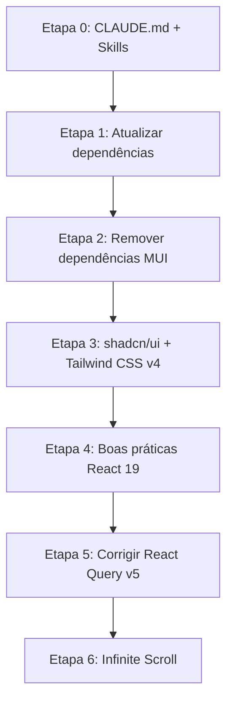

# 🚀 SpaceXplorer — Plano de Modernização

> **Projeto:** React SpaceXplorer (NASA Image API Explorer)
> **Data:** 27/09/2026
> **Status:** ✅ Concluído (27/09/2026)

---

## 📌 Visão Geral

O SpaceXplorer é uma aplicação React + TypeScript que consome a **NASA Images API** para buscar e exibir imagens e vídeos do espaço. O projeto foi criado há algum tempo e precisa ser modernizado em múltiplas frentes:

- Stack desatualizada (React 18, Vite 4, TanStack Query v4)
- UI baseada em Material UI (será substituída por **shadcn/ui + Tailwind CSS v4**)
- Problemas de arquitetura no uso do React Query
- Ausência de paginação / infinite scroll

---

## 📊 Estado Atual do Projeto

### Estrutura de Arquivos

```
react-spacexplorer/
├── src/
│   ├── components/
│   │   ├── CardItem.tsx          # Card de exibição de resultados
│   │   ├── ErrorComponent.tsx    # Componente de erro
│   │   ├── Loading.tsx           # Skeleton loading
│   │   └── Search.tsx            # Busca + listagem (componente monolítico)
│   ├── models/
│   │   └── interfaces.tsx        # Tipagem da NASA API
│   ├── pages/
│   │   └── layout/
│   │       ├── Footer.tsx        # Footer fixo
│   │       └── Header.tsx        # Header (não utilizado — inline no App.tsx)
│   ├── utils/
│   │   ├── ConvertCamelCase.tsx   # Utilitário não utilizado
│   │   └── DateUtils.tsx          # Utilitário não utilizado
│   ├── App.tsx                   # Componente raiz + tema + providers
│   ├── App.css                   # Estilos legado (template Vite)
│   ├── index.css                 # Estilos globais
│   └── main.tsx                  # Entry point
├── .env                          # API URL
├── package.json
├── tsconfig.json
├── vite.config.ts
└── index.html
```

### Dependências Atuais

| Pacote | Versão Atual | Versão Mais Recente | Ação |
|---|---|---|---|
| `react` | ^18.2.0 | **19.3.0** | ⬆️ Atualizar |
| `react-dom` | ^18.2.0 | **19.3.0** | ⬆️ Atualizar |
| `vite` | ^4.4.0 | **8.3.x** | ⬆️ Atualizar |
| `@vitejs/plugin-react-swc` | ^3.3.2 | **latest** | ⬆️ Atualizar |
| `typescript` | ^5.0.2 | **5.x latest** | ⬆️ Atualizar |
| `@tanstack/react-query` | ^4.29.25 | **5.104.x** | ⬆️ Migrar para v5 |
| `@tanstack/react-query-devtools` | ^4.29.25 | **5.x** | ⬆️ Migrar para v5 |
| `@tanstack/eslint-plugin-query` | ^4.29.25 | **5.x** | ⬆️ Migrar para v5 |
| `axios` | ^1.4.0 | **latest** | ⬆️ Atualizar |
| `date-fns` | ^2.30.0 | **4.x** | ⬆️ Atualizar |
| `@mui/material` | ^5.14.0 | — | ❌ Remover |
| `@mui/icons-material` | ^5.14.0 | — | ❌ Remover |
| `@emotion/react` | ^11.11.1 | — | ❌ Remover |
| `@emotion/styled` | ^11.11.0 | — | ❌ Remover |
| `eslint` | ^8.44.0 | **9.x (flat config)** | ⬆️ Atualizar |
| `prettier` | 3.0.0 | **latest** | ⬆️ Atualizar |

### Novas Dependências

| Pacote | Versão | Propósito |
|---|---|---|
| `tailwindcss` | **v4+** | Estilização utility-first |
| `@tailwindcss/vite` | latest | Plugin Vite para Tailwind v4 |
| `shadcn` (CLI) | latest | Componentes UI acessíveis |
| `lucide-react` | latest | Ícones (substitui @mui/icons-material) |
| `class-variance-authority` | latest | Variantes de componentes (dep. do shadcn) |
| `clsx` + `tailwind-merge` | latest | Merge de classes CSS |

---

## 🐛 Problemas Identificados no Código Atual

### 1. QueryClient recriado a cada render

```tsx
// ❌ PROBLEMA: App.tsx linha 19
// QueryClient é instanciado DENTRO do componente,
// recriando a instância a cada re-render
function MyApp() {
    const queryClient = new QueryClient(); // ← novo a cada render
    ...
}
```

**Impacto:** O cache do React Query é destruído e recriado a cada re-render. Todas as queries são refetched desnecessariamente.

### 2. Hook customizado definido dentro do componente

```tsx
// ❌ PROBLEMA: Search.tsx linhas 16-29
// useSearch é definido DENTRO do componente Search
// Hooks devem ser funções top-level ou em arquivos separados
export default function Search() {
    function useSearch(query: string) {
        return useQuery({ ... });
    }
}
```

**Impacto:** Viola as regras dos hooks do React. O hook é recriado a cada render, podendo causar comportamento inesperado.

### 3. Paginação hardcoded

```tsx
// ❌ PROBLEMA: Search.tsx linha 24
// page e page_size são fixos
`${baseUrl}/search?q=${queryParam}&page=2&page_size=5`
//                                  ^^^^^^^^^^^^^^^^^^^^
```

**Impacto:** Apenas 5 resultados da página 2 são exibidos. Sem navegação entre páginas.

### 4. useEffect sem array de dependências

```tsx
// ❌ PROBLEMA: App.tsx linhas 24-26
// useEffect roda a CADA render
useEffect(() => {
    document.title = title ? title : 'React Nasa';
}); // ← falta []
```

### 5. Código morto / não utilizado

- `Header.tsx` — não é importado (header está inline no App.tsx)
- `ConvertCamelCase.tsx` — função nunca exportada nem utilizada
- `DateUtils.tsx` — código de exemplo com `console.log`, nunca utilizado
- `App.css` — estilos do template padrão do Vite, sem uso

### 6. Tipagem com referência circular

```tsx
// ❌ PROBLEMA: interfaces.tsx
export interface Item {
    item: Item;  // ← referência a si mesma, provavelmente erro
    ...
}
export interface Data {
    data: Data;  // ← mesma coisa
    ...
}
```

### 7. Extensão `.tsx` em arquivos sem JSX

- `ConvertCamelCase.tsx` → deveria ser `.ts`
- `DateUtils.tsx` → deveria ser `.ts`
- `interfaces.tsx` → deveria ser `.ts`

### 8. console.log em produção

```tsx
// App.tsx linha 22
console.log('ENV: ', import.meta.env.VITE_TITLE);
```

### 9. Uso de `index` como key no map

```tsx
// Search.tsx linha 147
{data?.collection?.items.map((item, index) => (
    <div key={index}> // ← deveria usar um ID único
```

---

## 🗺️ Etapas de Modernização

### Etapa 1 — Atualizar todas as dependências

> **Objetivo:** Atualizar React, Vite, TypeScript e TanStack Query para as versões mais recentes.

**Tarefas:**

- [x] Atualizar `react` e `react-dom` para **19.3.x**
- [x] Atualizar `vite` para **8.x** e `@vitejs/plugin-react-swc` para latest
- [x] Atualizar `typescript` para **5.x latest**
- [x] Migrar `@tanstack/react-query` de **v4 → v5**
- [x] Atualizar `axios` para latest
- [x] Atualizar `date-fns` para **v4**
- [x] Atualizar `eslint` para **v9** com flat config
- [x] Atualizar `prettier` para latest
- [x] Atualizar `@types/react` e `@types/react-dom` para latest
- [x] Ajustar `tsconfig.json` para as novas opções recomendadas
- [x] Ajustar `vite.config.ts` para compatibilidade com Vite 8

**Mudanças importantes na migração do TanStack Query v4 → v5:**

- `useQuery({ queryKey, queryFn })` — API mantida, mas callbacks `onSuccess`/`onError`/`onSettled` removidos do `useQuery`
- `useInfiniteQuery` — `getNextPageParam` agora é obrigatório
- Imports mudam de `@tanstack/react-query` (mantido)
- `QueryClientProvider` mantém mesma API
- `cacheTime` renomeado para `gcTime`

---

### Etapa 2 — Remover dependências desnecessárias

> **Objetivo:** Remover MUI, Emotion e qualquer dependência que será substituída.

**Remover:**

- [x] `@mui/material`
- [x] `@mui/icons-material`
- [x] `@emotion/react`
- [x] `@emotion/styled`

**Limpar código morto:**

- [x] Remover `src/utils/ConvertCamelCase.tsx`
- [x] Remover `src/utils/DateUtils.tsx`
- [x] Remover `src/pages/layout/Header.tsx` (não utilizado)
- [x] Remover `src/App.css` (estilos não utilizados do template Vite)
- [x] Remover `console.log` de produção

---

### Etapa 3 — Instalar e configurar shadcn/ui + Tailwind CSS v4

> **Objetivo:** Novo design system com Tailwind CSS v4 + shadcn/ui.

**Tarefas:**

- [x] Instalar `tailwindcss` e `@tailwindcss/vite`
- [x] Configurar o plugin Tailwind no `vite.config.ts`
- [x] Configurar path aliases (`@/`) no `vite.config.ts` e `tsconfig.json`
- [x] Atualizar `src/index.css` com `@import "tailwindcss"`
- [x] Inicializar shadcn/ui com `npx shadcn@latest init`
- [x] Instalar componentes shadcn necessários:
  - `button`, `input`, `card`, `skeleton`, `alert`, `badge`
  - `separator`, `tooltip` (`scroll-area` e `dialog` não instalados — sem uso no momento)
- [x] Instalar `lucide-react` como substituição dos ícones MUI
- [x] Definir tema customizado (cores space/NASA, dark mode)

**Design System — Diretrizes:**

- **Tema:** Dark-first, com tons de deep space blue (`#0B1120`, `#1E293B`) e acentos em cyan/electric blue
- **Tipografia:** Inter (já em uso) + pesos variados
- **Cards:** Glassmorphism com backdrop-blur, bordas translúcidas
- **Animações:** Micro-animações com `transition` e `@keyframes` para hover, loading e scroll

---

### Etapa 4 — Aplicar boas práticas do React 19

> **Objetivo:** Código moderno seguindo as convenções do React 19.

**Tarefas:**

- [x] Mover `QueryClient` para fora do componente (instância estável)
- [x] Extrair hooks customizados para arquivos separados (`src/hooks/`)
- [x] Separar responsabilidades do `Search.tsx` (hook de API, componente de UI, componente de busca)
- [x] Remover `useEffect` desnecessários (ex: document.title → pode usar a tag `<title>` diretamente)
- [x] Adicionar `useEffect` com array de dependências onde necessário
- [x] Usar IDs únicos como `key` em vez de `index`
- [x] Corrigir tipagens circulares em `interfaces.tsx`
- [x] Renomear `.tsx` → `.ts` em arquivos sem JSX
- [x] Criar estrutura de pastas organizada:

```
src/
├── components/
│   └── ui/          # Componentes shadcn gerados
├── features/
│   └── search/
│       ├── components/
│       │   ├── SearchInput.tsx
│       │   ├── SearchResults.tsx
│       │   └── SearchCard.tsx
│       ├── hooks/
│       │   └── useSearch.ts
│       ├── types/
│       │   └── nasa-api.ts
│       └── api/
│           └── nasa-api.ts
├── layouts/
│   ├── RootLayout.tsx
│   ├── Header.tsx
│   └── Footer.tsx
├── lib/
│   └── utils.ts      # cn() e utilitários globais
├── providers/
│   ├── QueryProvider.tsx
│   └── ThemeProvider.tsx
├── App.tsx
├── main.tsx
└── index.css
```

---

### Etapa 5 — Corrigir React Query (TanStack Query v5)

> **Objetivo:** Implementação correta do TanStack Query v5 com boas práticas.

**Problemas a corrigir:**

- [x] `QueryClient` fora do componente
- [x] Hook `useSearch` extraído para arquivo dedicado
- [x] Separar `queryFn` em uma service layer (`src/features/search/api/nasa-api.ts`)
- [x] Configurar `staleTime` e `gcTime` de forma adequada
- [x] Adicionar `enabled` condicional para evitar queries com string vazia
- [x] Usar `queryKey` factories para consistência
- [x] Configurar `retry` e error handling global

**Implementação de referência:**

```typescript
// src/features/search/api/nasa-api.ts
import axios from 'axios';
import type { NasaSearchResponse } from '../types/nasa-api';

const BASE_URL = import.meta.env.VITE_BASE_URL;

export async function searchNasaImages(
  query: string,
  page: number = 1,
  pageSize: number = 20,
): Promise<NasaSearchResponse> {
  const { data } = await axios.get<NasaSearchResponse>(
    `${BASE_URL}/search`,
    { params: { q: query, page, page_size: pageSize } },
  );
  return data;
}
```

```typescript
// src/features/search/hooks/useSearch.ts
import { useInfiniteQuery } from '@tanstack/react-query';
import { searchNasaImages } from '../api/nasa-api';

export const searchKeys = {
  all: ['search'] as const,
  query: (q: string) => [...searchKeys.all, q] as const,
};

export function useSearchInfinite(query: string) {
  return useInfiniteQuery({
    queryKey: searchKeys.query(query),
    queryFn: ({ pageParam }) => searchNasaImages(query, pageParam),
    initialPageParam: 1,
    getNextPageParam: (lastPage, _allPages, lastPageParam) => {
      const totalHits = lastPage.collection.metadata.total_hits;
      const currentCount = lastPageParam * 20;
      return currentCount < totalHits ? lastPageParam + 1 : undefined;
    },
    enabled: query.trim().length > 0,
    staleTime: 5 * 60 * 1000, // 5 minutos
    gcTime: 30 * 60 * 1000,   // 30 minutos
  });
}
```

---

### Etapa 6 — Implementar Paginação Infinita (Infinite Scroll)

> **Objetivo:** Ao rolar a página, novos resultados são carregados automaticamente.

**Estratégia:**

1. Usar `useInfiniteQuery` do TanStack Query v5
2. Usar **Intersection Observer API** nativa para detectar scroll
3. Componente sentinel invisível no final da lista

**Tarefas:**

- [x] Migrar de `useQuery` → `useInfiniteQuery`
- [x] Criar hook `useIntersectionObserver` para detectar o final da lista
- [x] Implementar componente sentinel (`<div ref={loadMoreRef} />`)
- [x] Adicionar loading indicator ao carregar mais itens
- [x] Exibir total de resultados encontrados (`total_hits` da API)
- [x] Ajustar `page_size` para **20** itens por página
- [x] Limpar cache ao trocar o termo de busca (já resolvido pela queryKey)

**Implementação de referência:**

```typescript
// src/hooks/useIntersectionObserver.ts
import { useEffect, useRef } from 'react';

export function useIntersectionObserver(
  callback: () => void,
  options?: IntersectionObserverInit
) {
  const ref = useRef<HTMLDivElement>(null);

  useEffect(() => {
    const element = ref.current;
    if (!element) return;

    const observer = new IntersectionObserver(
      (entries) => {
        if (entries[0].isIntersecting) {
          callback();
        }
      },
      { threshold: 0.1, ...options }
    );

    observer.observe(element);
    return () => observer.disconnect();
  }, [callback, options]);

  return ref;
}
```

---

## 📐 Configuração do Ambiente

### Etapa Pré-requisito — CLAUDE.md

Criar arquivo `CLAUDE.md` na raiz do projeto com as instruções e convenções para que agentes de IA possam auxiliar no desenvolvimento de forma consistente.

### Skills necessárias

Criar skills customizadas para padronizar a geração de código:

| Skill | Propósito |
|---|---|
| **React 19** | Boas práticas, hooks, patterns atualizados |
| **Tailwind CSS v4** | Configuração, classes utility, responsividade |
| **shadcn/ui** | Uso de componentes, customização de tema |
| **TanStack Query v5** | Queries, mutations, infinite queries, cache |
| **Design System** | Paleta de cores, tipografia, espaçamento, animações |

---

## 📅 Ordem de Execução



> **IMPORTANTE:** Cada etapa deve ser concluída e testada antes de iniciar a próxima. As etapas 1 e 2 podem ser executadas juntas. As etapas 4 e 5 são interdependentes.

---

## ✅ Critérios de Conclusão

- [x] Todas as dependências atualizadas e sem warnings
- [x] Zero referências a MUI/Emotion no código
- [x] UI redesenhada com shadcn/ui + Tailwind CSS v4
- [x] Dark/Light mode funcionando
- [x] Busca com debounce funcional
- [x] Infinite scroll carregando próximas páginas automaticamente
- [x] Código limpo, sem código morto, sem console.log
- [x] Tipagens corretas (sem `any`, sem referências circulares)
- [x] Build de produção sem erros
