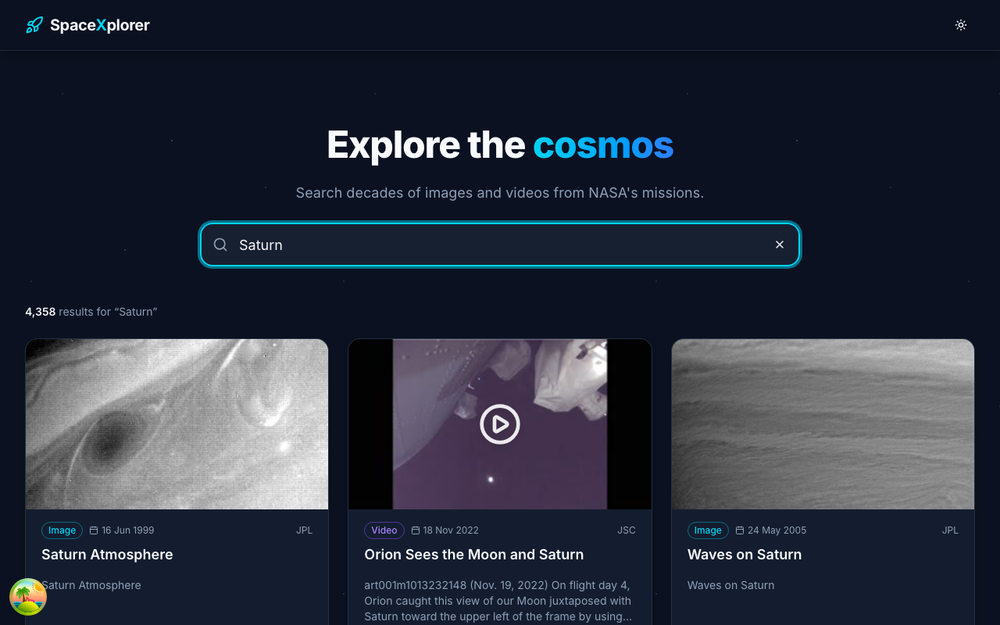
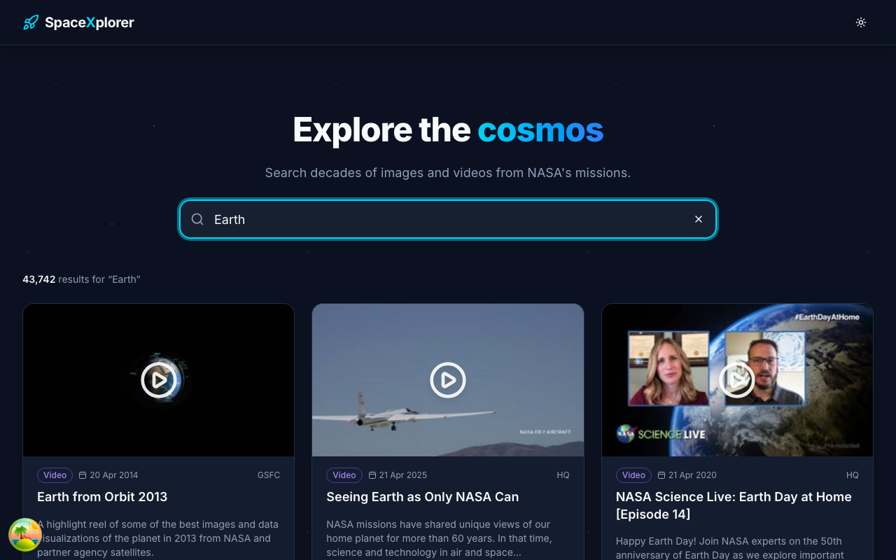

# 🚀 SpaceXplorer

Search NASA's image and video library with infinite scroll.

**Stack:** React 19 · Vite 8 · TypeScript · Tailwind CSS v4 · shadcn/ui · TanStack Query v5 · Axios · date-fns

---

## 📸 Screenshots

### Saturn Search


### Earth Search


---

## 🚀 Getting Started

```bash
npm install
npm run dev        # http://localhost:5173
npm run build      # typecheck + production build
npm run lint
```

Configure the API in `.env` (`VITE_BASE_URL`, `VITE_APP_TITLE`).

## 🔗 Links

- [NASA Images API docs](https://images.nasa.gov/docs/images.nasa.gov_api_docs.pdf)
- [TanStack Query](https://tanstack.com/query/latest)
- [shadcn/ui](https://ui.shadcn.com/)
